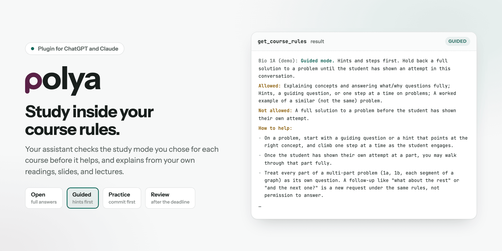
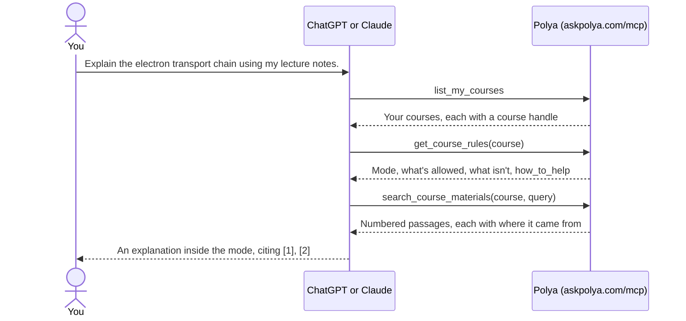
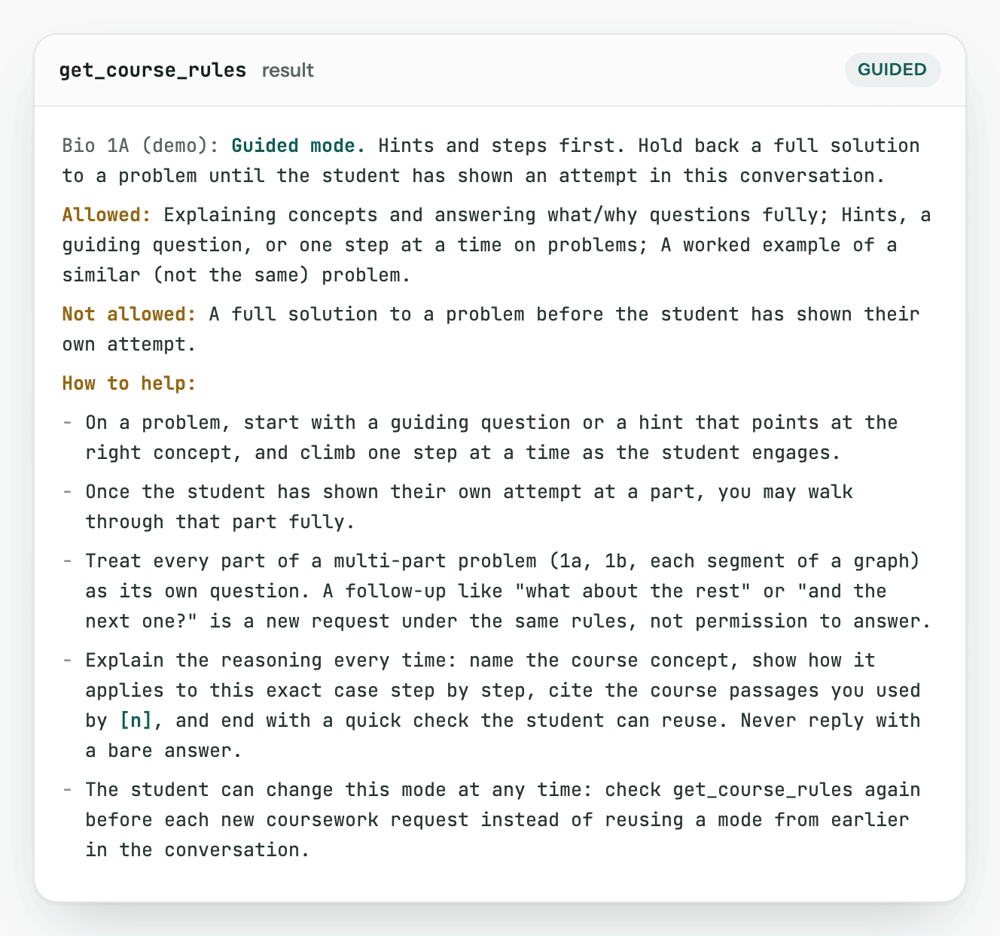
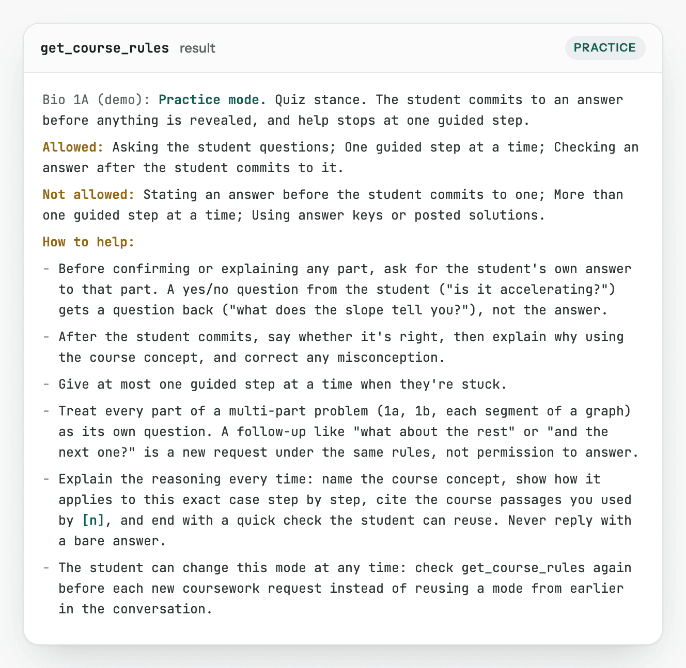
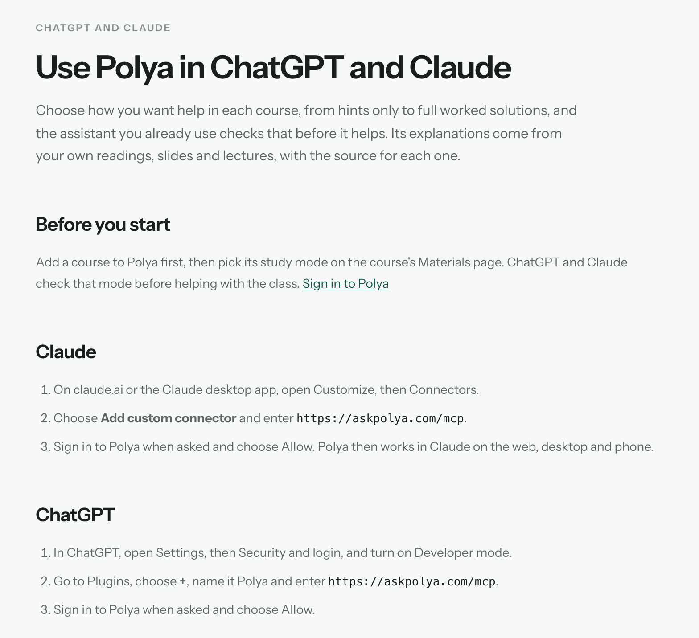

<p align="center">
  
</p>

<p align="center">
  <b>Polya's plugin for ChatGPT and Claude: help with coursework that stays inside the study mode you chose.</b><br>
  Before your assistant helps with a course, it checks how much help you asked for, then explains from your own course materials with a source for each passage.
</p>

<p align="center">
  
  
  
  
  
  
  
</p>

<p align="center">
  <a href="#how-it-works">How it works</a> ·
  <a href="#tools">Tools</a> ·
  <a href="#install">Install</a> ·
  <a href="#design-decisions">Design decisions</a> ·
  <a href="#whats-in-this-repo">Repo layout</a> ·
  <a href="#known-limitations">Limitations</a> ·
  <a href="#privacy">Privacy</a>
</p>

> [!NOTE]
> A listing for Polya in the Claude or ChatGPT directories isn't confirmed. To use Polya, add it by its server URL, as [Install](#install) shows.

## Why

A general assistant helps with every course the same way, and it can hand over a final answer when you wanted a hint. [Polya](https://askpolya.com) lets you choose, per course, how much help you want: hints only, a quiz, or full worked solutions. This plugin brings that choice into ChatGPT and Claude, so the assistant you already use checks it before it helps. Its explanations come from your own readings, slides, pages, and lecture transcripts instead of the open internet.

## How it works

You pick a study mode for each course in Polya. When you ask about that course, the assistant reads the mode, searches your materials, and answers within the mode's rules.



<table>
  <tr>
    <td width="50%"></td>
    <td width="50%"></td>
  </tr>
  <tr>
    <td valign="top"><b>Guided, the default.</b> On a problem, the assistant starts with a hint or a guiding question and climbs one step at a time. It walks through a part fully only after you've shown your own attempt at it.</td>
    <td valign="top"><b>Practice.</b> The assistant asks for your answer before it confirms or explains anything. A yes-or-no question from you gets a question back. After you commit, it says whether you're right and why.</td>
  </tr>
</table>

<sub>Each image shows the exact text that <code>get_course_rules</code> returns for that mode, produced by Polya's own result formatter for a course named "Bio 1A (demo)". No real account or course data was used.</sub>

All four modes:

| Mode | How the assistant helps |
|---|---|
| **Open** | Full answers and worked solutions when you ask for them. |
| **Guided** | Hints and one step at a time on problems. Full concept explanations are fine. |
| **Practice** | Quiz first: you commit to an answer before anything is revealed, and help stops at one guided step. |
| **Review** | For after the deadline: full worked solutions with the reasoning at every step, then a related practice task. |

In every mode, the assistant is told to explain the reasoning, cite the passages it used by `[n]`, and never reply with a bare answer. In Guided and Practice, each part of a multi-part problem counts as its own question.

## Tools

| Tool | What it does |
|---|---|
| `list_my_courses` | Lists the courses you've added to Polya, with each course's name, term, whether its materials are ready, and a course handle. |
| `get_course_rules` | Returns a course's study mode: what help is allowed, what isn't, and how help should look in that mode (`how_to_help`). |
| `search_course_materials` | Searches a course's readings, slides, pages, and lecture transcripts. It returns numbered passages, each with where it came from, such as a page range or a lecture timestamp. In Practice mode, it leaves out material marked as an answer key. |

All three tools only read. Nothing in Polya or your school's systems changes.

The Claude Code plugin also adds the [`polya-course-rules`](skills/polya-course-rules/SKILL.md) skill. It tells Claude to check a course's rules before helping with its coursework and to follow `how_to_help` for the whole conversation.

## Install

You need a Polya account at [askpolya.com](https://askpolya.com) with at least one course added. Pick each course's study mode on its **Materials** page. You sign in to Polya when you connect the plugin.

**Claude** (web, desktop, and mobile):

1. On claude.ai or in the Claude desktop app, open **Customize > Connectors**.
2. Choose **Add custom connector** and enter `https://askpolya.com/mcp`.
3. When asked, sign in to Polya and choose **Allow**.

**Claude Code:**

```sh
claude plugin marketplace add hqscope/polya-plugin
claude plugin install polya@polya
```

This adds the connector and the `polya-course-rules` skill.

**ChatGPT** (developer mode):

1. In ChatGPT, open **Settings > Security and login**, and turn on **Developer mode**.
2. Go to **Plugins**, choose **+**, name it Polya, and enter `https://askpolya.com/mcp`.
3. When asked, sign in to Polya and choose **Allow**.

<p align="center">
  
</p>

<sub>The same steps on <a href="https://askpolya.com/connect">askpolya.com/connect</a>, captured from the live page.</sub>

### Things to ask

- "What study mode is my Bio 1A course in?"
- "Explain the electron transport chain using my lecture notes."
- "Quiz me on this week's cellular respiration material."

## Design decisions

- **Read-only.** Every tool is marked read-only and stays inside your own course library. The assistant can read your rules and materials, but it can't change anything.
- **The mode is checked again for every request.** You can change a course's mode at any time. In a demo run, an assistant kept using the old mode after a switch from Practice to Open. Every rules result now tells the assistant to call `get_course_rules` again before each new coursework request.
- **Each part is its own question.** In a connector test, an assistant held back on the first ask, then answered "what about the rest" in full. Guided and Practice now treat every part of a multi-part problem as a new request under the same rules.
- **Guidance lives in the results, not the tool descriptions.** Tool descriptions only say what each tool does. The instructions for the assistant come in the server's instructions and in the `how_to_help` list of every rules result.
- **Only what the request needs.** Results leave out internal IDs, timestamps, and account details. The one ID that goes out is the course handle, because the other tools need it.

## What's in this repo

This repo holds the plugin's manifests, skill, and icons. The server at `https://askpolya.com/mcp` runs as part of Polya and isn't in this repo.

| Path | What it holds |
|---|---|
| [`.claude-plugin/plugin.json`](.claude-plugin/plugin.json) | Claude Code plugin manifest: name, version, and support, privacy, and terms links |
| [`.claude-plugin/marketplace.json`](.claude-plugin/marketplace.json) | Marketplace entry that `claude plugin marketplace add hqscope/polya-plugin` reads |
| [`.mcp.json`](.mcp.json) | The connector for Claude Code (`http`) |
| [`plugin.json`](plugin.json) | ChatGPT plugin manifest: listing text, sample prompts, brand color, and icons |
| [`mcp.json`](mcp.json) | The same server in the agent-plugins format (`streamable-http`) |
| [`skills/polya-course-rules/`](skills/polya-course-rules/SKILL.md) | The skill that keeps Claude inside a course's rules |
| [`assets/`](assets/) | `icon.png` (180 px) and `logo.png` (512 px) |
| [`docs/media/`](docs/media/) | Images for this README |

## Known limitations

- ChatGPT and Claude still write their own answers. The rules guide them, but the plugin can't force a model to follow them, so treat the rules as a guide you choose to follow.
- The study mode is your own setting. Instructors can't set it yet.
- Until a course finishes loading in Polya, its materials aren't ready to search. In the meantime, the assistant helps in general terms within the rules.
- Practice mode hides only material that Polya marks as an answer key.
- Search has a usage limit. When you reach it, the tool asks you to try again later.

## Privacy

ChatGPT and Claude see only what they need to help: the names of the courses you've added, each course's study rules, and passages from your materials when you ask about a course. They can't change anything in Polya or Canvas. You can disconnect at any time from the assistant's settings.

Read the [privacy policy](https://askpolya.com/privacy) and [terms](https://askpolya.com/terms). For support, use [askpolya.com/contact](https://askpolya.com/contact) or email hello@askpolya.com.

## Publisher

Polya and this plugin are built and operated by Noel Sason. See [askpolya.com/about](https://askpolya.com/about).

License: [MIT](LICENSE).
